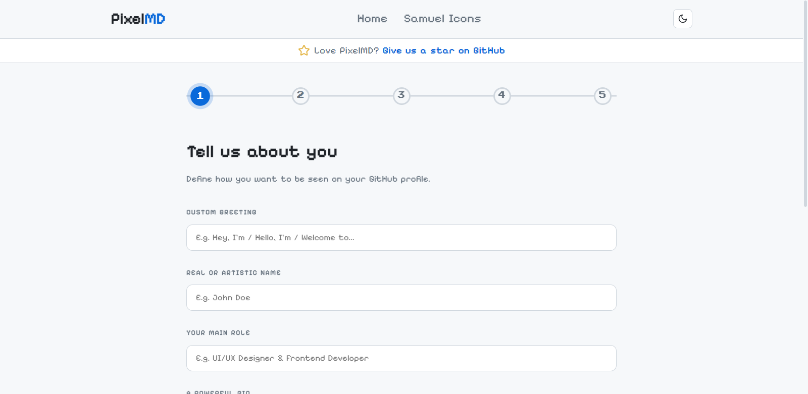
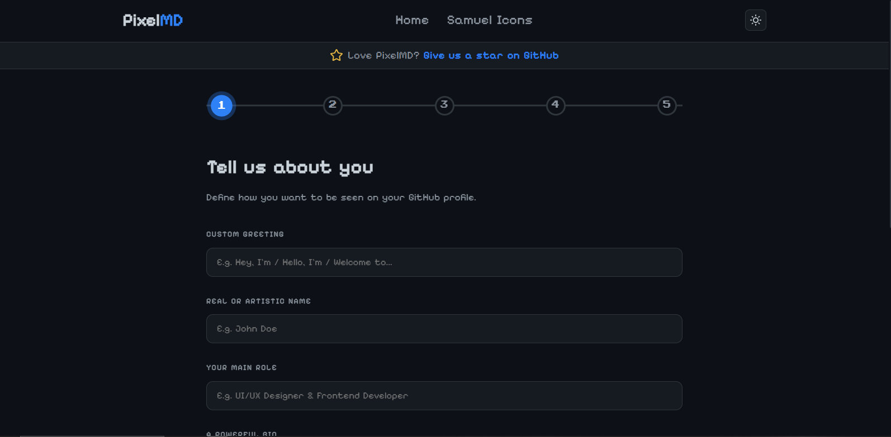

# 🎮 PixelMD | GitHub Profile README Generator

<p align="center">
  
  
  
  
  
</p>

<p align="center">
  <strong>"Level Up Your Profile"</strong> — Create stunning GitHub profiles with a nostalgic 8-bit pixel art aesthetic and modern Glassmorphism UI.
</p>

<p align="center">
  <a href="https://samuelcubano.github.io/PixelMD-github-profile-readme-generator/"><strong>🚀 Live Demo</strong></a> • 
  <a href="#-features"><strong>✨ Features</strong></a> • 
  <a href="#-tech-stack"><strong>🛠️ Tech Stack</strong></a> • 
  <a href="#-icon-gallery"><strong>🎨 Icons</strong></a> • 
  <a href="#-installation"><strong>🚀 Installation</strong></a> • 
  <a href="#-contributing"><strong>🤝 Contributing</strong></a>
</p>

---

## 📸 Preview

<div align="center">
  <h3>Light Mode</h3>
  
  
  <h3 style="margin-top: 2rem;">Dark Mode</h3>
  
</div>

---

## ✨ Features

<table>
  <tr>
    <td width="50%">
      <h3>🎨 Pixel Art Interface</h3>
      <p>A nostalgic gaming-inspired UI that makes creating your profile fun and engaging.</p>
    </td>
    <td width="50%">
      <h3>🌗 Light & Dark Mode</h3>
      <p>Seamlessly switch between themes with a beautiful animated toggle.</p>
    </td>
  </tr>
  <tr>
    <td width="50%">
      <h3>🎭 114 Pixel Art Icons</h3>
      <p>Choose from our curated pixel art icon collection or use your own.</p>
    </td>
    <td width="50%">
      <h3>📋 One-Click Export</h3>
      <p>Copy your generated markdown instantly or download as README.md.</p>
    </td>
  </tr>
  <tr>
    <td width="50%">
      <h3>📊 GitHub Stats</h3>
      <p>Integrate your GitHub stats with beautiful themes (Tokyo Night, Dracula, etc.).</p>
    </td>
    <td width="50%">
      <h3>🌐 Social Links</h3>
      <p>Connect all your social platforms with pixel-styled icons.</p>
    </td>
  </tr>
</table>

---

## 🛠️ Tech Stack

<p align="center">
  
  
  
  
</p>

| Category | Technology |
|----------|-------------|
| **Framework** | Angular 21 (v21.2.7) |
| **Language** | TypeScript |
| **UI Styling** | CSS3 / Glassmorphism |
| **Icons** | Lucide Icons (UI) + 114 Custom Pixel Art (profile) |
| **Testing** | Vitest |
| **Deployment** | GitHub Pages / Netlify |

---

## 🎨 Icon Gallery

<p align="center">
  <strong>114 pixel art icons</strong> ready to use — every icon below is live in the app.
</p>

<p align="center">
  
  
  
</p>

### 🆕 New Icons

<p align="center">
  <strong>Two brand new icons</strong> just landed in the collection. They are already selectable in <b>Step 3 — Tech Arsenal</b>.
</p>

<table>
  <tr>
    <td align="center">
      
      <br>
      <b>GSAP</b> <sub>🆕 NEW</sub>
    </td>
    <td align="center">
      
      <br>
      <b>OpenStreetMap</b> <sub>🆕 NEW</sub>
    </td>
  </tr>
</table>

| Icon | Name | Category | File | Format |
|:----:|:-----|:---------|:-----|:-------|
|  | **OpenStreetMap** | Tools | `openstreetmap` | WebP |
|  | **GSAP** | Frontend | `gsap` | WebP |

---

### 📦 All Technology Icons

### 🖥️ Operating Systems <sub>(3)</sub>

<table>
  <tr>
    <td align="center">
      
      <br>
      <b>Linux</b>
    </td>
    <td align="center">
      
      <br>
      <b>Windows</b>
    </td>
    <td align="center">
      
      <br>
      <b>iOS</b>
    </td>
  </tr>
</table>

### 💻 Programming Languages <sub>(16)</sub>

<table>
  <tr>
    <td align="center">
      
      <br>
      <b>JavaScript</b>
    </td>
    <td align="center">
      
      <br>
      <b>TypeScript</b>
    </td>
    <td align="center">
      
      <br>
      <b>PHP</b>
    </td>
    <td align="center">
      
      <br>
      <b>Python</b>
    </td>
    <td align="center">
      
      <br>
      <b>Java</b>
    </td>
    <td align="center">
      
      <br>
      <b>C#</b>
    </td>
  </tr>
  <tr>
    <td align="center">
      
      <br>
      <b>C++</b>
    </td>
    <td align="center">
      
      <br>
      <b>C</b>
    </td>
    <td align="center">
      
      <br>
      <b>Ruby</b>
    </td>
    <td align="center">
      
      <br>
      <b>Kotlin</b>
    </td>
    <td align="center">
      
      <br>
      <b>Rust</b>
    </td>
    <td align="center">
      
      <br>
      <b>Dart</b>
    </td>
  </tr>
  <tr>
    <td align="center">
      
      <br>
      <b>Bash Script</b>
    </td>
    <td align="center">
      
      <br>
      <b>Go</b>
    </td>
    <td align="center">
      
      <br>
      <b>SQL</b>
    </td>
    <td align="center">
      
      <br>
      <b>Swift</b>
    </td>
  </tr>
</table>

### 🎨 Frontend <sub>(6)</sub>

<table>
  <tr>
    <td align="center">
      
      <br>
      <b>HTML5</b>
    </td>
    <td align="center">
      
      <br>
      <b>CSS3</b>
    </td>
    <td align="center">
      
      <br>
      <b>Bootstrap</b>
    </td>
    <td align="center">
      
      <br>
      <b>TailwindCSS</b>
    </td>
    <td align="center">
      
      <br>
      <b>Leaflet</b>
    </td>
    <td align="center">
      
      <br>
      <b>GSAP</b> <sub>🆕 NEW</sub>
    </td>
  </tr>
</table>

### ⚙️ Backend <sub>(2)</sub>

<table>
  <tr>
    <td align="center">
      
      <br>
      <b>Node.js</b>
    </td>
    <td align="center">
      
      <br>
      <b>Express.js</b>
    </td>
  </tr>
</table>

### 🧩 Frameworks <sub>(11)</sub>

<table>
  <tr>
    <td align="center">
      
      <br>
      <b>React</b>
    </td>
    <td align="center">
      
      <br>
      <b>Next.js</b>
    </td>
    <td align="center">
      
      <br>
      <b>Angular</b>
    </td>
    <td align="center">
      
      <br>
      <b>Astro</b>
    </td>
    <td align="center">
      
      <br>
      <b>Vue.js</b>
    </td>
    <td align="center">
      
      <br>
      <b>Svelte</b>
    </td>
  </tr>
  <tr>
    <td align="center">
      
      <br>
      <b>Laravel</b>
    </td>
    <td align="center">
      
      <br>
      <b>Django</b>
    </td>
    <td align="center">
      
      <br>
      <b>Flask</b>
    </td>
    <td align="center">
      
      <br>
      <b>FastAPI</b>
    </td>
    <td align="center">
      
      <br>
      <b>NestJS</b>
    </td>
  </tr>
</table>

### 🗄️ Databases <sub>(9)</sub>

<table>
  <tr>
    <td align="center">
      
      <br>
      <b>PostgreSQL</b>
    </td>
    <td align="center">
      
      <br>
      <b>MySQL</b>
    </td>
    <td align="center">
      
      <br>
      <b>MongoDB</b>
    </td>
    <td align="center">
      
      <br>
      <b>MariaDB</b>
    </td>
    <td align="center">
      
      <br>
      <b>SQLite</b>
    </td>
    <td align="center">
      
      <br>
      <b>Redis</b>
    </td>
  </tr>
  <tr>
    <td align="center">
      
      <br>
      <b>Firestore</b>
    </td>
    <td align="center">
      
      <br>
      <b>DynamoDB</b>
    </td>
    <td align="center">
      
      <br>
      <b>Supabase</b>
    </td>
  </tr>
</table>

### 🔥 Backend as a Service <sub>(1)</sub>

<table>
  <tr>
    <td align="center">
      
      <br>
      <b>Firebase</b>
    </td>
  </tr>
</table>

### ☁️ Cloud & Deployment <sub>(7)</sub>

<table>
  <tr>
    <td align="center">
      
      <br>
      <b>AWS</b>
    </td>
    <td align="center">
      
      <br>
      <b>Google Cloud</b>
    </td>
    <td align="center">
      
      <br>
      <b>DigitalOcean</b>
    </td>
    <td align="center">
      
      <br>
      <b>Vercel</b>
    </td>
    <td align="center">
      
      <br>
      <b>Railway</b>
    </td>
    <td align="center">
      
      <br>
      <b>Netlify</b>
    </td>
  </tr>
  <tr>
    <td align="center">
      
      <br>
      <b>Cloudflare</b>
    </td>
  </tr>
</table>

### 🐳 DevOps & Infrastructure <sub>(10)</sub>

<table>
  <tr>
    <td align="center">
      
      <br>
      <b>Docker</b>
    </td>
    <td align="center">
      
      <br>
      <b>Kubernetes</b>
    </td>
    <td align="center">
      
      <br>
      <b>Terraform</b>
    </td>
    <td align="center">
      
      <br>
      <b>Ansible</b>
    </td>
    <td align="center">
      
      <br>
      <b>Jenkins</b>
    </td>
    <td align="center">
      
      <br>
      <b>CloudFormation</b>
    </td>
  </tr>
  <tr>
    <td align="center">
      
      <br>
      <b>AWS Sam</b>
    </td>
    <td align="center">
      
      <br>
      <b>Nginx</b>
    </td>
    <td align="center">
      
      <br>
      <b>Prometheus</b>
    </td>
    <td align="center">
      
      <br>
      <b>Grafana</b>
    </td>
  </tr>
</table>

### 🛠️ Tools & Editors <sub>(14)</sub>

<table>
  <tr>
    <td align="center">
      
      <br>
      <b>VS Code</b>
    </td>
    <td align="center">
      
      <br>
      <b>Git</b>
    </td>
    <td align="center">
      
      <br>
      <b>GitHub</b>
    </td>
    <td align="center">
      
      <br>
      <b>GitLab</b>
    </td>
    <td align="center">
      
      <br>
      <b>Git Bash</b>
    </td>
    <td align="center">
      
      <br>
      <b>Vite</b>
    </td>
  </tr>
  <tr>
    <td align="center">
      
      <br>
      <b>Figma</b>
    </td>
    <td align="center">
      
      <br>
      <b>LibreSprite</b>
    </td>
    <td align="center">
      
      <br>
      <b>DBeaver</b>
    </td>
    <td align="center">
      
      <br>
      <b>Toad</b>
    </td>
    <td align="center">
      
      <br>
      <b>Insomnia</b>
    </td>
    <td align="center">
      
      <br>
      <b>Postman</b>
    </td>
  </tr>
  <tr>
    <td align="center">
      
      <br>
      <b>Biome</b>
    </td>
    <td align="center">
      
      <br>
      <b>OpenStreetMap</b> <sub>🆕 NEW</sub>
    </td>
  </tr>
</table>

### 🤖 AI & Assistants <sub>(15)</sub>

<table>
  <tr>
    <td align="center">
      
      <br>
      <b>OpenAI</b>
    </td>
    <td align="center">
      
      <br>
      <b>Anthropic</b>
    </td>
    <td align="center">
      
      <br>
      <b>Gemini</b>
    </td>
    <td align="center">
      
      <br>
      <b>DeepSeek</b>
    </td>
    <td align="center">
      
      <br>
      <b>Perplexity</b>
    </td>
    <td align="center">
      
      <br>
      <b>Meta AI</b>
    </td>
  </tr>
  <tr>
    <td align="center">
      
      <br>
      <b>GitHub Copilot</b>
    </td>
    <td align="center">
      
      <br>
      <b>Cursor AI</b>
    </td>
    <td align="center">
      
      <br>
      <b>Claude Code</b>
    </td>
    <td align="center">
      
      <br>
      <b>GitHub Copilot</b>
    </td>
    <td align="center">
      
      <br>
      <b>Ollama</b>
    </td>
    <td align="center">
      
      <br>
      <b>LangChain</b>
    </td>
  </tr>
  <tr>
    <td align="center">
      
      <br>
      <b>Hugging Face</b>
    </td>
    <td align="center">
      
      <br>
      <b>OpenCode</b>
    </td>
    <td align="center">
      
      <br>
      <b>KiloCode</b>
    </td>
  </tr>
</table>

### 🎮 Fun & Highlights <sub>(11)</sub>

<table>
  <tr>
    <td align="center">
      
      <br>
      <b>Pokeball</b>
    </td>
    <td align="center">
      
      <br>
      <b>Minecraft Diamond</b>
    </td>
    <td align="center">
      
      <br>
      <b>Zelda</b>
    </td>
    <td align="center">
      
      <br>
      <b>Diamond Sword</b>
    </td>
    <td align="center">
      
      <br>
      <b>Console</b>
    </td>
    <td align="center">
      
      <br>
      <b>Coffee</b>
    </td>
  </tr>
  <tr>
    <td align="center">
      
      <br>
      <b>Headphones</b>
    </td>
    <td align="center">
      
      <br>
      <b>Midheart</b>
    </td>
    <td align="center">
      
      <br>
      <b>Fullheart</b>
    </td>
    <td align="center">
      
      <br>
      <b>Emptyheart</b>
    </td>
    <td align="center">
      
      <br>
      <b>Valorant</b>
    </td>
  </tr>
</table>

### 🌐 Social Icons <sub>(9)</sub>

Used in <b>Step 4 — Digital Presence</b> to link your profiles.

<table>
  <tr>
    <td align="center">
      
      <br>
      <b>Web</b>
    </td>
    <td align="center">
      
      <br>
      <b>GitHub</b>
    </td>
    <td align="center">
      
      <br>
      <b>LinkedIn</b>
    </td>
    <td align="center">
      
      <br>
      <b>Instagram</b>
    </td>
    <td align="center">
      
      <br>
      <b>Facebook</b>
    </td>
    <td align="center">
      
      <br>
      <b>X (Twitter)</b>
    </td>
  </tr>
  <tr>
    <td align="center">
      
      <br>
      <b>Discord</b>
    </td>
    <td align="center">
      
      <br>
      <b>YouTube</b>
    </td>
    <td align="center">
      
      <br>
      <b>Twitch</b>
    </td>
  </tr>
</table>

---

> **Tip:** Icons live in <code>src/app/data/data.ts</code> and are served from the PixelMD icon CDN
> (<code>https://icons-samuel.netlify.app</code>). All icons are 64×64 px with transparent background.
> New icons added to the CDN are available in the app as soon as they are registered in <code>data.ts</code>.

---

## 🚀 Installation

### Prerequisites
- Node.js (v18 or higher)
- npm or yarn
- Angular CLI (`npm install -g @angular/cli`)

### Step 1: Clone the Repository
```bash
git clone https://github.com/SamuelCubano/PixelMD-github-profile-readme-generator.git
cd PixelMD-github-profile-readme-generator
```

### Step 2: Install Dependencies
```bash
npm install
# or
yarn install
```

### Step 3: Start Development Server
```bash
ng serve
# or
npm start
```
Navigate to `http://localhost:4200/` in your browser. The application will automatically reload if you change any of the source files.

### Step 4: Build for Production
```bash
ng build --configuration=production
```
The build artifacts will be stored in the `dist/` directory.

---

## 🎯 How to Use

1. **Step 1 - Tell us about you**: Add your greeting, name, role, and bio
2. **Step 2 - Your Highlights**: Customize the bullet icons for work, learning, collaboration, etc. using the Fun & Highlights collection
3. **Step 3 - Tech Arsenal**: Select your technologies from 114 pixel art icons
4. **Step 4 - Digital Presence**: Add your social media and GitHub profile links
5. **Step 5 - Generate**: Copy your markdown or download the README.md file

---

## 🤝 Contributing

We love contributions! Here's how you can help make PixelMD even better:

### Ways to Contribute
- 🐛 Report bugs and issues
- 🎨 Add new pixel art icons
- 💡 Suggest new features
- 📖 Improve documentation
- 🌍 Add translations

### Getting Started

1. **Star ⭐ the repository** to show your support
2. **Fork 🍴** the repository
3. **Create a feature branch**
   ```bash
   git checkout -b feature/amazing-feature
   ```
4. **Make your changes** and commit them
   ```bash
   git commit -m 'Add some amazing feature'
   ```
5. **Push to the branch**
   ```bash
   git push origin feature/amazing-feature
   ```
6. **Open a Pull Request** 🎉

### Icon Contribution Guidelines
If you want to add new pixel art icons:
- Icons should be 64x64 pixels
- Use a pixel art style consistent with existing icons
- Export as PNG or WebP with transparent background
- Upload the file to the icon CDN as `https://icons-samuel.netlify.app/<id>.png` (or `.webp`)
- Add the icon entry to `src/app/data/data.ts`
- If your icon is WebP, add `ext: 'webp'` to the entry (defaults to `png`):
  ```ts
  { id: 'myicon', name: 'My Icon', category: 'tools', ext: 'webp' }
  ```
- Use one of the valid categories: `os`, `languages`, `frontend`, `backend`, `frameworks`, `database`, `baas`, `cloud`, `devops`, `tools`, `ai`, `fun`
- Add the icon to the [🎨 Icon Gallery](#-icon-gallery) section of this README so the collection stays in sync

> **Latest additions:** 🆕 OpenStreetMap (`openstreetmap`, category `tools`) and GSAP (`gsap`, category `frontend`) are the two newest icons in the collection.

---

## ⭐ Support the Project

If PixelMD helped you create an awesome GitHub profile, please consider:
- Giving us a **⭐ Star** on GitHub
- Sharing the project with other developers
- Contributing new icons or features
- Following the repository for updates

Your support motivates us to keep adding more components and styles! 🚀

---

## 🎨 Credits

Developed with ☕ and pixel love by **[Samuel Cubano](https://github.com/SamuelCubano)** from Venezuela.

Special thanks to:
- The Angular team for the amazing framework
- [Lucide Icons](https://lucide.dev/) for the beautiful icon set
- All contributors who help make this project better

---

## 📄 License

This project is licensed under the MIT License - see the [LICENSE](LICENSE) file for details.

---

<p align="center">
  
  <br>
  <em>Made with love for the developer community</em>
</p>
